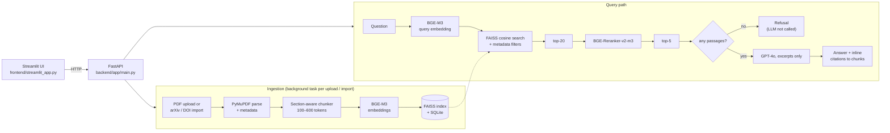

# PaperLens — AI-Powered Research Assistant (v1 / MVP)

[](https://github.com/oussemaAbdaoui/paperlens/actions/workflows/tests.yml)

PaperLens lets a researcher ask questions across their **entire paper corpus** and
get **grounded, cited answers**. Every answer is traceable to a specific paper
and page — it is a research accelerator, not a document chatbot. When no
retrieved passage supports an answer, it refuses instead of generating one.

This repository implements the **MVP (Milestones 1–3, modules M1–M8)** defined in
the specification book `PaperLens-Specification-Book.docx` (included in the repo).

## Architecture



State: SQLite (collections, papers, chunks) + FAISS (vectors), under the data
directory (`PAPERLENS_DATA_DIR`, `/data` in Docker). Internal design details
(DB schema, class diagrams) belong in the TDD, not here (spec §10).

---

## What's implemented (MVP scope)

| Module | Feature | Where (under `backend/app/`) |
|--------|---------|-------|
| **M1** | Corpus management: PDF upload (one or several files from the UI), arXiv/DOI import, collections, dedup | `routers/corpus.py`, `routers/collections.py`, `services/importer.py` |
| **M2** | Document processing: PyMuPDF parsing + metadata extraction | `services/processing.py` |
| **M3** | Section-aware chunking (100–600 tokens, never crossing sections) | `services/chunking.py` |
| **M4** | Embeddings — **BGE-M3** | `services/embeddings.py` |
| **M5** | Vector indexing — **FAISS** (cosine via inner product) | `services/vectorstore.py` |
| **M6** | Retrieval — top-20 by cosine, metadata-filtered | `services/retrieval.py` |
| **M7** | Reranking — **BGE-Reranker-v2-m3**, top-20 → top-5 | `services/reranking.py` |
| **M8** | Question answering — grounded, cited, **GPT-4o** (configurable), with hallucination guard | `services/qa.py` |

The ingestion pipeline (M2 → M5) is orchestrated by `services/ingest.py`.

v2 modules (cross-paper comparison, literature review, gap detection) and all
"Cut" modules are **out of scope** and not built (spec §1.4, §3).

## Locked v1 technology (spec §7)

FastAPI · Streamlit · GPT-4o (env-configurable) · BGE-M3 · FAISS · BGE-Reranker-v2-m3 ·
PyMuPDF · RAGAS · Docker/compose · pytest. No swappability abstraction layers — by design.

---

## Quickstart

### With Docker (single command)

```bash
git clone https://github.com/oussemaAbdaoui/paperlens.git && cd paperlens
cp .env.example .env          # then set OPENAI_API_KEY in .env
docker-compose up --build
```

- API:      http://localhost:8000  (OpenAPI docs at `/docs`)
- Frontend: http://localhost:8501

The first start downloads the BGE-M3 and BGE-Reranker models into a cached
volume (a few minutes). Data (SQLite + PDFs + FAISS index) persists in the
`paperlens_data` volume.

### Local development (no Docker)

```bash
python -m venv .venv && source .venv/bin/activate    # Windows: .venv\Scripts\activate
pip install -r requirements.txt
export OPENAI_API_KEY=sk-...                          # Windows: set OPENAI_API_KEY=...

# Terminal 1 — API
uvicorn app.main:app --app-dir backend --reload

# Terminal 2 — UI
streamlit run frontend/streamlit_app.py
```

### Running without model downloads / GPU (CI, offline)

Set `PAPERLENS_EMBEDDING_BACKEND=hash` to use a deterministic, seeded offline
embedder and an order-preserving reranker. The full pipeline (chunk → embed →
FAISS → retrieve → rerank → guard) runs end-to-end without downloads. Answer
generation still needs `OPENAI_API_KEY`. This is how the test suite runs.

---

## Run tests

The test suite runs fully **offline**: no API key, no model download, no GPU.
The embedder is the hash backend, the cross-encoder is replaced by an
order-preserving or keyword-scoring stub, and the LLM call (`qa._call_llm`) is
monkeypatched. A lean dependency set (no torch, sentence-transformers, openai,
streamlit or ragas) is enough:

```bash
python -m venv .venv && source .venv/bin/activate    # Windows: .venv\Scripts\activate
pip install -r requirements-test.txt
pytest
```

CI ([`.github/workflows/tests.yml`](.github/workflows/tests.yml)) does exactly
this on Python 3.11 for every push and pull request to `main`. `pytest` also
works in an environment built from the full `requirements.txt`.

What the tests check, by user story:

- `test_m3_chunking.py`, `test_chunking_invariants.py` — token bounds, never
  crossing a section boundary, page attribution, no text lost; includes
  adversarial and randomized layouts (US-05)
- `test_pipeline.py` — ingest → retrieve, metadata filters, collection scope (US-06/07)
- `test_retrieval_rerank.py` — top-20 → top-5 rerank wiring with a stub
  cross-encoder, filters applied before reranking, filtered scopes not starved (US-07)
- `test_m8_qa.py`, `test_qa_guard.py` — citation format, prompt contents,
  citations resolving to chunks, **hallucination guard** (no LLM call without
  passages; an LLM refusal is reported as ungrounded) (US-08)
- `test_hallucination_guard.py` — 20 out-of-scope queries all refuse (checklist §9)
- `test_m2_processing.py` — metadata extraction, no hallucinated fields (US-04)
- `test_m1_importer.py` — arXiv/DOI parsing + clear errors (US-02)
- `test_api.py`, `test_dedup.py` — collections CRUD, DOI/filename dedup, upload
  overwrite, QA endpoint refusal (US-01/02/03/08)
- `test_eval_metrics.py` — Recall@k / Precision@k / MRR (§8.3)

---

## Evaluation (spec §8)

The evaluation harness is in place; the benchmark data is not yet in the repo.
`eval/benchmark/README.md` defines the two files it needs — `papers.jsonl`
(50 arXiv papers across NLP/CV/XAI) and `questions.jsonl` (100 annotated QA
pairs) — of which only a tiny illustrative `sample_questions.jsonl` is
committed. Once they exist:

```bash
python scripts/build_benchmark_corpus.py            # fetch + index eval/benchmark/papers.jsonl
python -m eval.run_eval --questions eval/benchmark/questions.jsonl
python -m eval.run_eval --questions eval/benchmark/questions.jsonl --generation   # add RAGAS generation metrics
```

The runner exits non-zero if any metric falls below its §8.3/§8.4 threshold, so
it can gate a release in CI (checklist §9). Retrieval metrics are dependency-free;
generation metrics use RAGAS and require an LLM key. No benchmark results are
reported yet.

---

## Configuration

All settings are environment variables (see `.env.example`). Key ones:

| Variable | Default | Meaning |
|----------|---------|---------|
| `OPENAI_API_KEY` | — | Required for M8 generation |
| `PAPERLENS_LLM_MODEL` | `gpt-4o` | Generation model (US-08: configurable) |
| `PAPERLENS_EMBEDDING_BACKEND` | `bge` | `bge` (real) or `hash` (offline) |
| `PAPERLENS_RETRIEVE_TOP_K` | `20` | M6 candidate count |
| `PAPERLENS_RERANK_TOP_K` | `5` | M7 final count |
| `PAPERLENS_CHUNK_MIN_TOKENS` / `MAX_TOKENS` | `100` / `600` | M3 bounds |
| `PAPERLENS_SEED` | `42` | Reproducibility |
| `PAPERLENS_DATA_DIR` | `./data` | SQLite, PDFs and FAISS index |

---

## Spec traceability

This codebase is the implementation of `PaperLens-Specification-Book.docx` v1.0.
The MVP acceptance checklist (§9) is tracked in `ACCEPTANCE.md`.
